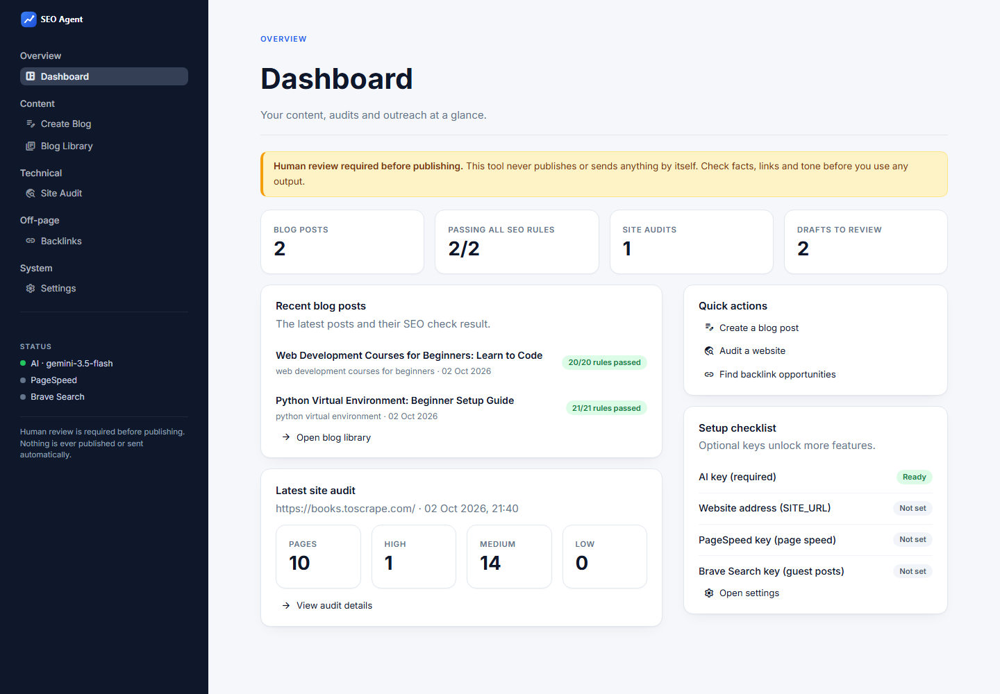
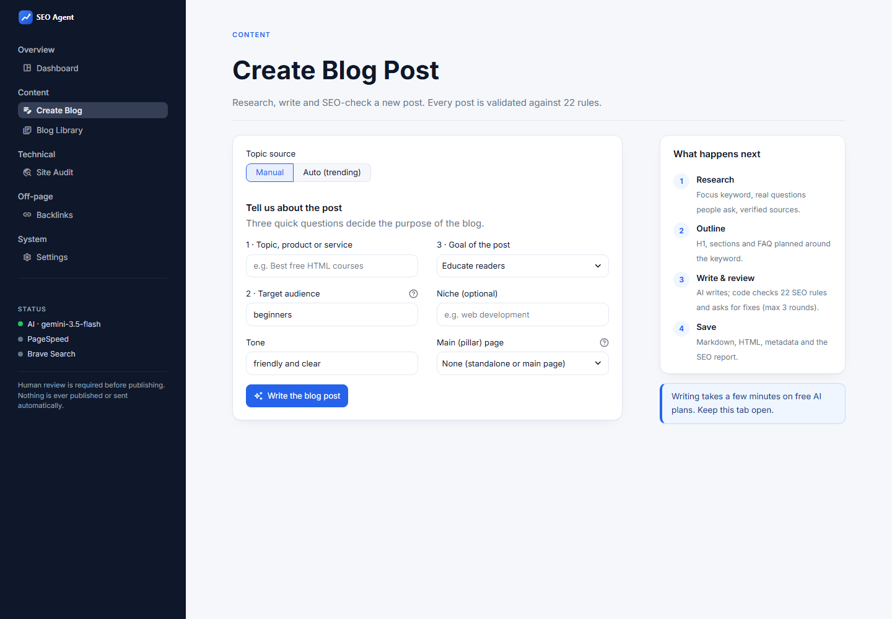
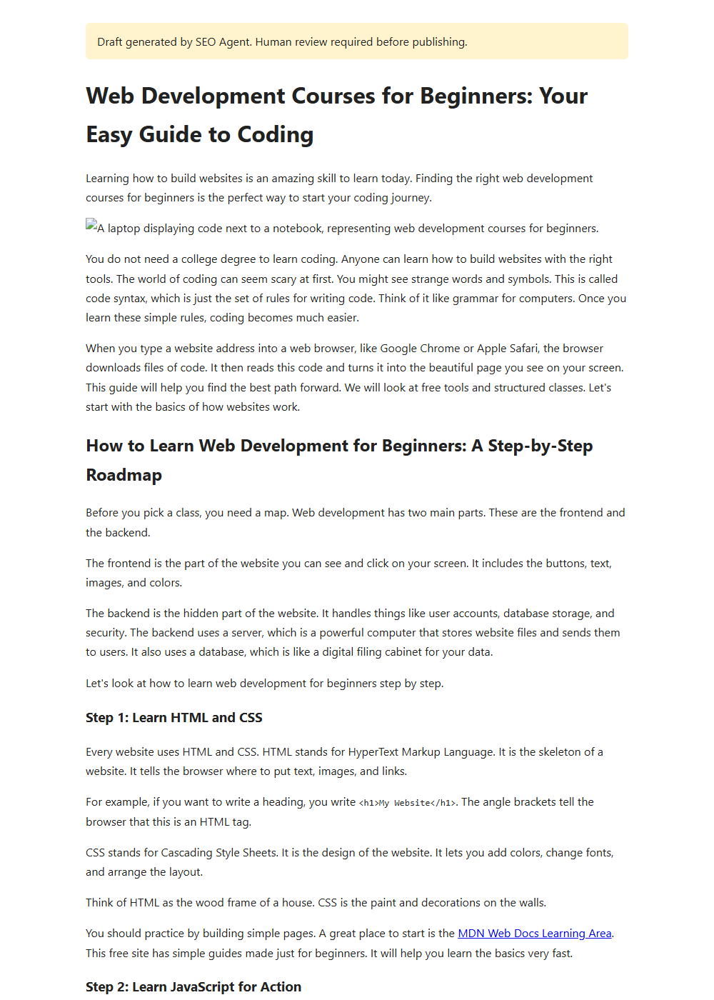

# SEO Agent

A beginner-friendly Python project that researches, writes, checks and audits for SEO.

1. **Finds topics** people search for (Google Trends, with Google autocomplete as a fallback), or takes your own topic.
2. **Writes SEO-optimised blog posts** that follow strict on-page rules.
3. **Checks every post with plain code** (22 rules) and sends the exact failures back to the AI until it passes (max 3 rounds).
4. **Links main (pillar) pages and child pages** in both directions.
5. **Audits a website** for technical SEO problems: duplicate content, missing alt text, 404s, broken links, LCP/FCP.
6. **Helps with backlinks** by finding opportunities and drafting pitches for **you** to approve and send.
7. **Sends a finished post to WordPress as a draft** (optional). You press Publish yourself.

> **Human review is required before publishing.** This tool never publishes, posts or sends anything by itself.
> The optional WordPress step only creates *drafts*, and only after you confirm.



---

## Contents
- [Quick start](#quick-start)
- [Configuration (.env)](#configuration-env)
- [How to use](#how-to-use)
- [Example output](#example-output)
- [Where files are saved](#where-files-are-saved)
- [Tests](#tests)
- [Project structure](#project-structure)
- [Safety and quality guardrails](#safety-and-quality-guardrails)
- [Troubleshooting](#troubleshooting)
- [Future improvements](#future-improvements)

More detail: [docs/architecture.md](docs/architecture.md) (how it works) and [docs/seo-rules.md](docs/seo-rules.md) (every rule).

---

## Quick start

You need **Python 3.11+**.

**Windows (PowerShell):**
```powershell
cd "E:\IT HUB\seo-agent"
python -m venv venv
venv\Scripts\activate          # your prompt now starts with (venv)
python -m pip install --upgrade pip
pip install -r requirements.txt
copy .env.example .env
```

**macOS / Linux:**
```bash
python3 -m venv venv
source venv/bin/activate
pip install -r requirements.txt
cp .env.example .env
```

Then:
1. Get a free Gemini key at https://aistudio.google.com/apikey.
2. Open `.env` and paste the key after `LLM_API_KEY=`.
3. Check the setup:

```powershell
python config.py          # shows your settings, with keys masked
python main.py --help     # lists all commands
streamlit run app.py      # opens the web app at http://localhost:8501
```

Remember to activate the virtual environment (`venv\Scripts\activate`) every time you open a new terminal.

---

## Configuration (.env)

| Setting | Required? | What it's for |
|---|---|---|
| `LLM_API_KEY` | **Yes** | Your AI provider key |
| `LLM_BASE_URL`, `LLM_MODEL` | Yes (defaults set) | Which provider and model to use |
| `LLM_FALLBACK_MODEL` | Recommended | Backup model when the main one is overloaded |
| `SITE_URL` | Recommended | Your site, e.g. `https://myblog.com`, used for internal links and canonical tags |
| `PAGESPEED_API_KEY` | For page speed | Free key: https://developers.google.com/speed/docs/insights/v5/get-started |
| `BRAVE_SEARCH_API_KEY` | Optional | Finds guest-post/resource pages: https://brave.com/search/api/ |
| `WORDPRESS_URL`, `WORDPRESS_USERNAME`, `WORDPRESS_APP_PASSWORD` | Optional | Send posts to WordPress as drafts. Use an **Application Password** (WP Admin → Users → Profile), not your login password. `https://` only (`http://localhost` is allowed) |
| `LOG_LEVEL` | Optional | `INFO` (normal) or `DEBUG` (more detail) |

**Switching AI provider** only means changing `LLM_BASE_URL`, `LLM_MODEL` and `LLM_API_KEY`. Any
"OpenAI-compatible" API works:
- **Free tiers:** Google Gemini, Groq, OpenRouter (some models).
- **Paid:** OpenAI, Anthropic Claude.

`.env.example` has the exact values for each.

SEO rule numbers (minimum words, keyword count and so on) are in `config.py`.

---

## How to use

### Create a blog
```powershell
python main.py blog --mode manual
python main.py blog --mode auto --niche "web development"
python main.py blog --mode auto --niche "web development" --auto-pick --audience students --goal educate
python main.py blog --mode manual --main-page <main-page-slug>
```
- **`--mode manual`** asks 3 questions: topic, audience (+ tone), and goal (educate / rank / sales / leads).
- **`--mode auto`** shows the 5 best topics for your niche and lets you pick one.
- **`--main-page <slug>`** makes the new blog a child page. Its main page then gets a link to it automatically.

A blog takes about 2–10 minutes on a free AI plan.

### Check any blog against the rules
```powershell
python main.py validate --file tests/samples/sample_blog.md
python main.py validate --file my_post.md --keyword "coffee grinder" --check-links
```
`--check-links` also confirms that external links return HTTP 200 (needs the internet).

### Main and child pages
```powershell
python main.py pages                          # tree of main pages and their children
python main.py link-pages --main <slug>       # rebuild a main page's "Related Guides" links
```

### Technical SEO audit
```powershell
python main.py audit --url https://yoursite.com --max-pages 50
python main.py audit --url https://yoursite.com --max-pages 10 --no-speed --explain
```
- **`--no-speed`** skips PageSpeed.
- **`--no-external`** skips checking links to other sites.
- **`--explain`** adds a plain-language AI summary.

Only audit sites you own or have permission to test.

### Backlinks (drafts only)
```powershell
python main.py outreach --blog outputs/blogs/<slug> --niche "web development" --max-drafts 5
python main.py tracker
python main.py tracker --set <id> approved    # after you reviewed the draft
python main.py tracker --set <id> sent        # after YOU sent it yourself
```
- `outreach` finds opportunities and drafts pitches.
- `tracker` shows every opportunity with its ID and status.

### WordPress drafts (optional)
```powershell
python main.py wordpress --check                               # test the login
python main.py wordpress --blog outputs/blogs/<slug>           # send as a draft (asks first)
python main.py wordpress --blog outputs/blogs/<slug> --update  # refresh that draft
```
- The post is always sent with `status: draft`. Review it in WP Admin and press **Publish** yourself.
- It asks for confirmation, and asks again if the post failed the SEO checks.
- `--update` only changes a post that is still a draft. Published posts are never touched.
- Not sent: the JSON-LD (use Yoast or Rank Math) and local images (upload them and swap the links).
- The result is saved in `outputs/blogs/<slug>/wordpress.json` with a link to edit the draft.

In the web app: **Blog Library → WordPress** tab. **Settings → Test WordPress login** checks your keys.

### Web app
```powershell
streamlit run app.py
```
A sidebar menu with six pages:
- **Dashboard:** totals, recent posts, latest audit, and a setup checklist.
- **Create Blog:** the 3 questions (or trending topics), with live progress.
- **Blog Library:** SEO checks, a preview, downloads and WordPress drafts for every post.
- **Site Audit**, **Backlinks** and **Settings.**

The colours live in `.streamlit/config.toml`, and the styling in `src/ui/components.py`.



Example of a generated post (`post.html`):



---

## Example output

These are real runs from building this project.

**Auto mode** (`python main.py blog --mode auto --niche "web development" --auto-pick`):
```
Top topics for 'web development':
  1. web development courses   (relevance 100%, from google autocomplete)
  ...
Research done: keyword 'web development courses for beginners', 5 FAQ questions, 2 verified source(s).
  Verified: https://developer.mozilla.org/en-US/docs/Learn
  Rejected (page doesn't match the topic): https://en.wikipedia.org/wiki/Web_development
  Verified: https://pll.harvard.edu/course/cs50s-web-programming-python-and-javascript
First draft: 20/21 rules passed
    FAIL Reading level fits the audience - Reading ease 48.7 is below 60 for 'beginners'.
Fix round 1 of 3: fixing 1 problem(s)...
Round 1: 21/21 rules passed

SEO report for 'web development courses for beginners': 21/21 rules passed
RESULT: PASSED
Saved to: outputs\blogs\web-development-courses-for-beginners
Human review required before publishing.
```

**Validator on a weak post** (`python main.py validate --file tests/samples/sample_blog.md`):
```
[PASS] Focus keyword in title and H1: Keyword found in title tag and H1.
[FAIL] At least 1000 words: Only 173 words (827 short).
        Fix: Expand sections with useful detail, examples or steps. Don't add filler.
[FAIL] Logical H2/H3 structure: 'Picking a grind size' jumps from H2 to H4.
[FAIL] Descriptive link anchor text: Generic anchor text: 'click here'.
[FAIL] Statistics have a linked source: Statistic without a source link: ...
RESULT: 7 rule(s) failed
```

**Audit** (`python main.py audit --url https://books.toscrape.com --max-pages 10 --no-speed`),
run on a public practice site for crawlers:
```
Audit of https://books.toscrape.com/: 10 page(s) crawled
  High priority:   1     <- / and /index.html serve the same page (duplicate content)
  Medium priority: 14    <- missing meta descriptions, duplicate titles, a 93% near-duplicate
  Low priority:    0
```

---

## Where files are saved

```
outputs/
├── blogs/<slug>/
│   ├── post.md                 # article + settings block (re-check it with `validate`)
│   ├── post.html               # complete page: title, meta description, canonical, JSON-LD (Article + FAQ)
│   ├── meta.json               # title, description, slug, keywords, image alt
│   ├── validation_report.json  # PASS/FAIL/SKIP for every rule
│   └── wordpress.json          # only after sending: draft id + edit link
├── site_map.json               # main page <-> child page relationships
├── audits/<domain>-<date>/     # audit.md (readable) + audit.json
└── outreach/
    ├── backlink_tracker.csv    # opens in Excel / Google Sheets
    └── <slug>/                 # drafted pitches + search_queries.txt
logs/app.log                    # everything that happened, including full error details
```

The feature image is a placeholder path (`images/<slug>.jpg`). Add a real image with that name, or
change the path, before you publish. `outputs/` and `logs/` are git-ignored.

---

## Tests

```powershell
pytest            # all tests (about 200), offline and free, in a few seconds
pytest -v         # see every test name
pytest tests/test_seo_rules.py   # just one file
```
The AI, Google, Wikipedia and all websites are replaced with fakes in tests. Nothing costs money or
needs the internet.

| Test file | Covers |
|---|---|
| `test_text_tools.py` | word count, keyword count, density, headings, readability |
| `test_seo_rules.py` | every on-page rule, with passing and failing examples |
| `test_llm_client.py` | retries, fallback model, invalid JSON, friendly errors |
| `test_content.py` | outline, writer and metadata with a fake AI |
| `test_writer_reviewer_loop.py` | fix rounds, max-round limit, keeping the best draft |
| `test_research.py` | trends fallback, keyword cleanup, rejecting invented questions/URLs |
| `test_pipeline_smoke.py` | the whole pipeline end to end, offline |
| `test_internal_links.py` | site map, main <-> child links |
| `test_exporter.py` | Markdown, HTML, JSON-LD |
| `test_checks.py` | duplicates, alt text, 404s, broken links (sample HTML) |
| `test_audit.py` | polite crawler, robots.txt, page speed thresholds, report |
| `test_offpage.py` | tracker approval flow, spam filters, "never sends" guardrail |
| `test_wordpress.py` | drafts only, HTTPS only, confirmation, never changes published posts |
| `test_app.py` | the Streamlit app loads and handles errors |

---

## Project structure

```
seo-agent/
├── config.py              settings + SEO rule numbers
├── main.py                command line
├── app.py                 Streamlit web app (sidebar menu)
├── .streamlit/config.toml colour theme for the web app
├── assets/                logo files
├── prompts/               every AI prompt as a .txt file
├── src/
│   ├── llm/client.py      the ONLY file that talks to the AI
│   ├── models/schemas.py  data models (BlogRequest, KeywordPlan, BlogDraft, ...)
│   ├── research/          trends, keywords, FAQ questions, authority links
│   ├── content/           outline, writer, metadata, internal links
│   ├── validators/        SEO rules (plain code, no AI)
│   ├── agents/            research agent, writer <-> reviewer loop, pipeline
│   ├── audit/             crawler, checks, page speed, report
│   ├── offpage/           opportunities, outreach drafts, CSV tracker
│   ├── publish/           exporter, WordPress drafts
│   ├── ui/                web app pages (views.py) and styling (components.py)
│   └── utils/             logger, text tools
├── tests/                 pytest tests
└── docs/                  architecture.md, seo-rules.md, screenshots/
```

---

## Safety and quality guardrails

- **No invented facts.** The prompts forbid invented statistics, quotes and links. Any statistic must
  have a linked source in the same paragraph (checked in code).
- **Every source is verified.** It must be a high-authority site, return HTTP 200, and actually be about
  the topic. Invented URLs are rejected.
- **No keyword stuffing.** There is a density limit, and the writer is told a safe range of keyword uses.
- **Original writing only.** The writer gets keywords, questions and sources, never other sites' text.
- **Never publishes automatically.** Every output says "Human review required".
- **Polite crawling.** It obeys robots.txt and its Crawl-delay, stays on one domain, has a page limit,
  pauses between requests, and identifies itself.
- **Backlinks: assist, don't spam.**
  - It never creates accounts, submits, posts, emails or solves CAPTCHAs.
  - It rejects link sellers.
  - You approve every item before anything happens.
- **Secrets stay in `.env`.** That file is git-ignored, and keys are masked whenever they are shown.

---

## Troubleshooting

| Message | Fix |
|---|---|
| `The setting 'LLM_API_KEY' is missing` | Copy `.env.example` to `.env` and add your key |
| `LLM busy or slow (HTTP 503/429)... retrying` | Normal on free tiers. It retries and then uses `LLM_FALLBACK_MODEL`. If it keeps failing, wait a few minutes |
| `This model ... is no longer available` | Model retired: set `LLM_MODEL` to a current one (see your provider's model list) |
| `rejected your key (HTTP 401/403)` | Check `LLM_API_KEY` and `LLM_BASE_URL` belong to the same provider |
| `Google Trends unavailable (TooManyRequestsError)` | Normal: autocomplete is used instead |
| `PageSpeed Insights quota is used up` | Add a free `PAGESPEED_API_KEY` to `.env` |
| `No verified authority source found` | Add a trusted link by hand, or add the domain to `config.AUTHORITY_DOMAINS` |
| Changes to `.env` not picked up by the web app | Restart it (Ctrl+C, then `streamlit run app.py`) |
| `ModuleNotFoundError` | Activate the virtual environment first: `venv\Scripts\activate` |

Full error details are always in `logs/app.log`.

---

## Future improvements

**Bigger features**
- **LangGraph version of the pipeline.** Adds checkpoints (resume after a failure), human approval
  steps, and a tool-calling research agent. See [docs/architecture.md](docs/architecture.md#moving-to-langgraph-later).
- **WordPress: more than text.** Upload the feature image, set categories/tags, and fill in Yoast or
  Rank Math fields (focus keyword, meta description) through their REST APIs.
- **Scheduling.** Run research weekly, re-audit monthly, re-check links in old posts, and send a summary
  (Windows Task Scheduler or cron calling `main.py`).
- **AdSense readiness checklist.** An audit mode that checks site-level basics before applying:
  - About, Contact and Privacy Policy pages exist
  - Navigation is clear
  - There are enough substantial original posts
  - No thin or duplicate pages
  - Pages are mobile-friendly and fast
  - No broken pages
  - Content matches Google's published AdSense program policies (link them; there is no official minimum post count)
- **Analytics.** Connect Google Search Console (clicks, impressions, average position per post) and
  GA4. Then find posts to refresh: high impressions with a low click rate, or rankings slipping from page 1.

**Smaller improvements**
- Better topic ranking in auto mode (search volume, competition, search intent).
- Real feature images: generate or pick one, compress it, and use the alt text from metadata.
- Keyword cannibalisation check: warn when two of your posts target the same focus keyword.
- Content refresh: re-validate old posts after changing `config.py` rules.
- Multi-language support (prompts, readability formula, autocomplete language).
- Audit: canonical tags, `noindex`, sitemap.xml, redirect chains, structured-data validation.
- Optional local models (e.g. through Ollama's OpenAI-compatible API) for zero-cost generation.

---

## How this project was built

It was built in 11 phases, each one tested before the next:
0. setup
1. text tools and validator
2. AI client and writer
3. writer <-> reviewer loop
4. research and input modes
5. page structure and export
6. technical audit
7. backlink assistant
8. web app
9. documentation
10. WordPress drafts
