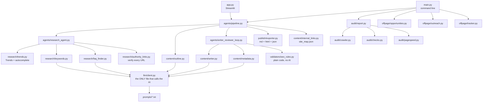
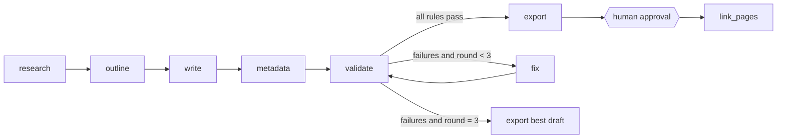

# Architecture

This document explains how the SEO Agent is put together, why it is built this way,
and how it could later move to LangGraph.

## The big idea

> **The AI writes and suggests. Plain code decides and checks.**

| Job | Who does it | Why |
|---|---|---|
| Choosing keywords, writing, fixing, drafting pitches, explaining audits | LLM | Needs language skills |
| SEO rules, keyword counts, link checks, duplicate detection, page speed ratings | Python code | Exact answers: free, fast, repeatable, testable |
| Publishing, sending outreach | **You** | Human review is required |

## Overview



## Creating a blog, step by step

```
BlogRequest (topic, audience, tone, goal, niche, main page)
   |  from the 3 manual questions, or a trending topic in auto mode
   v
1. RESEARCH  (agents/research_agent.py)
   keyword ideas      Google autocomplete                     code
   keyword choice     LLM picks, code cleans/limits            LLM + code
   FAQ questions      autocomplete questions, LLM picks,
                      code rejects any invented question       code + LLM + code
   sources            LLM suggests + Wikipedia search;
                      code keeps only high-authority, HTTP 200,
                      on-topic pages                           LLM + code
   -> KeywordPlan
   v
2. OUTLINE   (content/outline.py)  -> BlogOutline (H1, H2/H3, FAQ questions)
   v
3. WRITE + REVIEW LOOP  (agents/writer_reviewer_loop.py)
   write article -> metadata -> assemble draft -> VALIDATE (22 rules)
        all pass? ---------------------------------------> done
        failures -> fix article and/or metadata with the
                    exact failure reasons -> validate again
        stop after MAX_FIX_ROUNDS (3), keep the BEST draft
   -> BlogDraft + ValidationReport
   v
4. EXPORT  (publish/exporter.py)
   outputs/blogs/<slug>/post.md, post.html (with JSON-LD), meta.json, validation_report.json
   v
5. LINKING  (content/internal_links.py)
   register the page in outputs/site_map.json; if it is a child page,
   rebuild the main page's "Related Guides" section
```

### Data models (src/models/schemas.py)

| Model | Created by | Used by |
|---|---|---|
| `BlogRequest` | manual questions / auto mode | every step |
| `KeywordPlan` | research agent | outline, writer, loop |
| `BlogOutline` | outline step | writer |
| `BlogMetadata` | metadata step | draft assembly |
| `BlogDraft` | writer + metadata | validator, exporter |
| `RuleResult`, `ValidationReport` | validator | loop, exporter, UI |
| `AuditIssue`, `AuditReport` | audit checks | audit report, UI |
| `Opportunity` | off-page finder | CSV tracker, UI |

Pydantic checks each model, so bad data (for example broken JSON from the LLM) is caught
at the boundary instead of causing strange bugs later.

## The technical audit

```
crawler.py   polite crawl: robots.txt + Crawl-delay, same domain only, max pages, delay,
             shared connection; collects status, HTML and links per page
   v
checks.py    pure functions on HTML strings: duplicates (hash + 3-word-phrase similarity),
             titles/descriptions/H1, alt text, error pages, broken links (retry once,
             bot-blocking statuses marked "unverified")
pagespeed.py LCP + FCP, mobile + desktop, Google's good / needs improvement / poor thresholds
   v
report.py    sort by priority, add fix hints, optional AI explanation, save audit.json + audit.md
```

Collecting and judging are separate, so every check is tested with small HTML samples and no internet.

## Off-page assistant

```
opportunities.py  built-in platforms (filtered by niche) + optional Brave Search API
                  (footprints like "write for us"); rejects link sellers and social sites
tracker.py        CSV, statuses found -> draft -> approved -> sent (enforced in code)
outreach.py       LLM drafts a pitch / bio / submission text, saved as "DRAFT - NOT SENT"
```

There is no code that sends, posts or submits, and a test makes sure it stays that way.

## Error handling

| Problem | What happens |
|---|---|
| Missing API key | `ConfigError` with which key is missing and how to add it |
| No internet / API down | `LLMError` with a clear message |
| Rate limit or overload (429/503) | Wait 5, 10, 20, 40 s and retry; then try `LLM_FALLBACK_MODEL` |
| Invalid JSON from the LLM | One retry with the exact validation errors, then `LLMError` |
| Google Trends blocked | Fall back to Google autocomplete |
| Invented source URL | Rejected (domain, HTTP status and topic are checked) |
| Loop can't reach a pass | Stop after 3 rounds, save the best draft, list failed rules |
| PageSpeed quota used up | Noted in the report; the rest of the audit continues |
| Anything unexpected | One-line message on screen; full traceback only in `logs/app.log` |

## Moving to LangGraph later

The first version uses a **plain Python loop** on purpose: it's easy to read, debug and test.
[LangGraph](https://langchain-ai.github.io/langgraph/) becomes worth it when you want features
like pausing for human approval, resuming after a crash, or branching flows.

The current code already has the right shape: every step is a function that takes data and returns data.
Each one becomes a **node**, and the loop's `if` becomes a **conditional edge**.



A sketch of what it could look like (not part of this project, and LangGraph isn't installed):

```python
from typing import TypedDict
from langgraph.graph import StateGraph, END

class BlogState(TypedDict):
    request: BlogRequest
    plan: KeywordPlan
    outline: BlogOutline
    body: str
    metadata: BlogMetadata
    draft: BlogDraft
    report: ValidationReport
    round: int

def validate_node(state: BlogState) -> dict:
    draft = assemble_draft(state["request"], state["plan"], state["body"], state["metadata"])
    return {"draft": draft, "report": validate_blog(draft)}

def next_step(state: BlogState) -> str:
    if state["report"].passed or state["round"] >= config.MAX_FIX_ROUNDS:
        return "export"
    return "fix"

graph = StateGraph(BlogState)
graph.add_node("research", research_node)      # wraps research_agent.research()
graph.add_node("outline", outline_node)        # wraps create_outline()
graph.add_node("write", write_node)            # wraps write_blog()
graph.add_node("metadata", metadata_node)      # wraps create_metadata()
graph.add_node("validate", validate_node)
graph.add_node("fix", fix_node)                # wraps fix_blog(), increments round
graph.add_node("export", export_node)          # wraps save_blog()
graph.set_entry_point("research")
graph.add_edge("research", "outline")
graph.add_edge("outline", "write")
graph.add_edge("write", "metadata")
graph.add_edge("metadata", "validate")
graph.add_conditional_edges("validate", next_step, {"fix": "fix", "export": "export"})
graph.add_edge("fix", "validate")
graph.add_edge("export", END)
app = graph.compile()   # add a checkpointer to resume, interrupt_before=["export"] for approval
```

What you would gain:
- **Checkpoints:** a failed AI call on round 3 resumes from round 3, not from the start.
- **Human-in-the-loop:** pause before export, or before any outreach step, until you approve.
- **Tool-calling research agent:** let the model decide whether it needs more questions or another
  source, while code still verifies every result.
- **Visual graph and tracing** for debugging.

What stays the same: the validator, the prompts, the LLM client and all the plain-code checks.
Only the "glue" in `pipeline.py` and `writer_reviewer_loop.py` changes.
